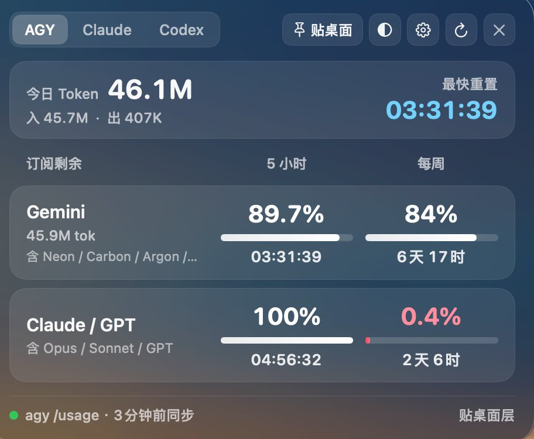
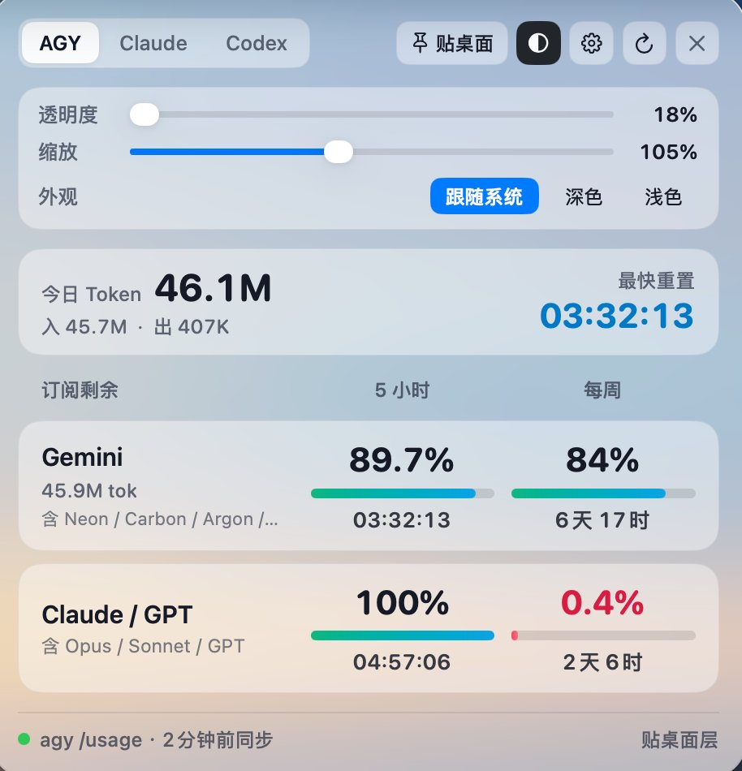
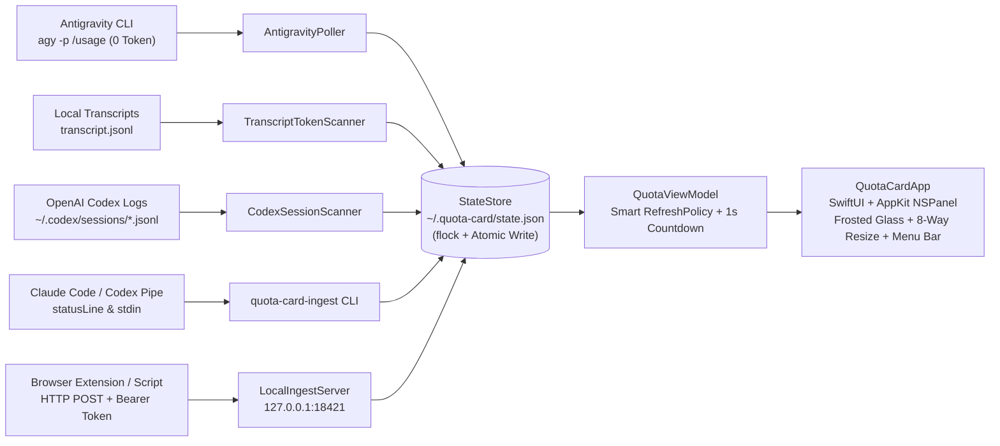

<div align="center">

# QuotaCard for macOS

**原生 macOS 毛玻璃桌面悬浮卡片 — 实时查看 AI 订阅剩余额度、重置倒计时与今日 Token 消耗**

[](https://github.com/kingben8898-source/QuotaCard/releases)
[](https://swift.org)
[](#技术栈与目录结构)
[](LICENSE)

简体中文 | [English](README_EN.md)

<br/>

<table>
  <tr>
    <td align="center" width="50%">
      
      <br/>
      <sub><b>深色毛玻璃主视图</b> · 双时间窗额度矩阵 + 今日 Token + 贴桌面层</sub>
    </td>
    <td align="center" width="50%">
      
      <br/>
      <sub><b>浅色毛玻璃 + 外观抽屉</b> · 实时调节透明度、缩放比例与主题</sub>
    </td>
  </tr>
</table>

</div>

---

## 项目简介

**QuotaCard** 是一款专为 macOS 打造的轻量级、零第三方依赖的原生桌面悬浮小组件（SwiftUI + AppKit）。

它可以以细腻的**毛玻璃悬浮卡片**形态贴合在你的桌面或置顶悬浮，让你无需反复打开终端或网页，即可一眼掌握 **Antigravity (`agy`)**、**Claude Code**、**OpenAI Codex** 以及自定义本地数据源的：

- **5 小时 & 每周双时间窗剩余额度百分比**
- **精准到秒的额度重置倒计时**
- **今日 Token 消耗总量（含输入 / 输出与分模型池统计）**

所有刷新均通过**官方无头命令**、**官方 `statusLine` 钩子**或**本机认证接口**完成，**不消耗模型 Token、无需常驻终端窗口、100% 本地运行**。

---

## 核心功能详解

### 1. 原生毛玻璃视觉与丝滑桌面交互
- **真·原生毛玻璃材质**：基于 AppKit `NSVisualEffectView` 与 SwiftUI 打造，支持实时调节毛玻璃透明度（`18% – 92%`），并提供**跟随系统 / 深色 / 浅色**三种外观风格。
- **贴桌面层 & 悬浮置顶一键切换**：
  - **贴桌面层（默认）**：卡片固定在桌面壁纸上方、普通应用窗口下方，像系统原生桌面小组件一样不遮挡日常编码与办公。
  - **悬浮置顶**：一键切换为置顶浮窗，随时在所有全屏与虚拟桌面（Spaces）中保持可见。
- **四周八向自由缩放（`75% – 145%`）**：卡片的四条边与四个角均支持按比例平滑拖拽缩放（macOS 15+ 原生双向缩放光标），也可通过顶部 `◐` 快捷抽屉或 `⚙` 设置滑块微调；窗口位置与缩放比例自动记忆，拔插外接显示器时自动做屏幕边界回弹保护。
- **零打扰菜单栏常驻**：采用 `LSUIElement` 无 Dock 图标运行；点击卡片右上角 `×` 仅隐藏卡片不退出，顶部菜单栏实时显示当前最低剩余额度与今日 Token 速览，随时一键唤出。

### 2. 双时间窗剩余额度矩阵与今日 Token 统计
- **清晰的双列矩阵布局**：以「模型池 | 5 小时 | 每周」对齐呈现剩余额度百分比与进度条，并依据剩余比例自动切换健康状态配色（充足 / 偏低 / 告急）。
- **实时重置倒计时**：顶部高亮「最快重置」倒计时，每个额度池下方同步显示各自重置剩余时间（24 小时内精确到 `HH:MM:SS`，超过 24 小时展示 `X天 X时`）。
- **精准今日 Token 聚合**：自动解析 Antigravity 本地对话日志（`transcript.jsonl`）、OpenAI Codex 会话日志（`~/.codex/sessions/`）及各 CLI 上报数据，统计当日总消耗、输入/输出拆分及各模型池占比，跨午夜自动归零，不混入昨日数据。
- **内置演示模式**：支持在设置中一键开启「强制显示演示数据」，未接入 CLI 时也可直观预览卡片布局与配色效果。

### 3. 智能省电后台刷新（无需常驻终端 · 0 Token 消耗）
- **完全脱离终端运行**：Antigravity 通过官方无头命令 `agy -p "/usage" --output-format json`（`num_turns: 0`, `total_tokens: 0`）静默拉取额度，OpenAI Codex 通过本地元数据指纹按需解析 `~/.codex/sessions/`，两者均无需常驻终端。
- **五种刷新策略（Antigravity 与 Codex 统一遵守，`⚙` 设置中随时切换）**：

| 刷新模式 | 触发机制 | 适用场景 |
| :--- | :--- | :--- |
| **智能省电（默认推荐）** | 每 30 秒极轻量检测本地活动（Codex 仅 `stat` 元数据指纹，空闲零读盘），**检测到新对话自动刷新**（2 分钟冷却防抖）+ **15 分钟兜底同步** + **倒计时归零延迟 5 秒自动刷** + **休眠/亮屏唤醒自动刷**（30 秒防抖） | 绝大多数 MacBook 用户，兼顾实时性与续航 |
| **每 5 分钟** | 后台每 5 分钟定时刷新 + 倒计时归零与唤醒刷新 | 高频多设备并行使用 |
| **每 10 分钟** | 后台每 10 分钟定时刷新 + 倒计时归零与唤醒刷新 | 常规多设备同步 |
| **每 15 分钟** | 后台每 15 分钟定时刷新 + 倒计时归零与唤醒刷新 | 轻度后台监控 |
| **仅手动** | 仅在点击卡片 `↻` 或设置页手动拉取按钮时刷新 | 极致省电 |

- **抗休眠与防卡死设计**：内置 macOS App Nap 活动保护、临时文件输出防管道死锁与子进程超时清理机制，长期挂后台依然稳定可靠。

### 4. 多 AI 平台支持与可扩展本地接口
顶部标签栏支持在 **AGY / Claude / Codex** 等平台之间自由切换：
- **Antigravity (`agy`)**：检测到已安装 `agy` CLI 后开箱即用，后台智能刷新实时额度，同时结合本地 `transcript.jsonl` 展示今日 Token 与分池明细。
- **OpenAI Codex**：自动扫描 `~/.codex/sessions/` 官方本地会话日志，**零配置同步 5 小时 & 每周剩余额度、重置倒计时与今日 Token**（支持跨天续聊会话精准去重与多 `limit_id` 池拆分），并与 Antigravity 共用智能省电策略；同时也保留 `quota-card-ingest --provider codex` 管道接入方式。
- **Claude Code (`claude`)**：在 `⚙` 设置页中提供**一键配置 `statusLine` 钩子**：
  - 自动备份原有 `~/.claude/settings.json`（生成 `.bak`）；
  - 采用链式转发设计，**完整保留你原本的自定义状态栏**；
  - 支持**一键还原配置**，安全无损。
- **本地认证 HTTP 接口（`127.0.0.1:18421`）**：预留标准 REST 接口，方便接入浏览器扩展（如 Gemini Web / ChatGPT Web）或自定义脚本。

### 5. 隐私与安全设计
- **100% 纯本地运行**：无遥测、无云端中转、不上传任何额度或对话内容。
- **严守官方边界**：绝不探测桌面端未公开端口、绝不劫持系统进程、绝不读取浏览器 Cookie 或 `auth.json` 等凭证文件。
- **安全本地接口**：HTTP 服务严格绑定 `127.0.0.1` 回环地址，首次启动自动生成 `0600` 权限的 32 字节随机 Bearer Token 并采用恒定时间校验。
- **并发安全存储**：状态文件 `~/.quota-card/state.json` 通过 `flock` 文件锁与原子替换写入，多进程并发更新不会损坏数据。

---

## 系统架构



---

## 安装与快速上手

### 环境要求
- **系统**：macOS 14.0 (Sonoma) 及以上（支持 Apple Silicon 与 Intel）
- **从源码构建**：Xcode Command Line Tools（Swift 6.0+），**无需安装完整 Xcode.app**

### 方式一：直接下载预编译版本（推荐）
1. 前往 [Releases](https://github.com/kingben8898-source/QuotaCard/releases) 下载最新的 `QuotaCard-macOS.zip`。
2. 解压后将 `QuotaCard.app` 拖入 `/Applications`（应用程序）文件夹。
3. 由于开源免费版本使用本地临时签名（Ad-hoc Signed），首次打开如遇到 macOS Gatekeeper 拦截提示，请在终端执行一次以下命令解除隔离属性后双击打开：
   ```bash
   xattr -cr /Applications/QuotaCard.app
   open /Applications/QuotaCard.app
   ```

### 方式二：从源码编译打包
```bash
git clone https://github.com/kingben8898-source/QuotaCard.git
cd QuotaCard
./scripts/build-app.sh
open dist/QuotaCard.app
```
打包完成后会在 `dist/QuotaCard.app` 生成完整的原生应用包（内置主程序、`quota-card-ingest` 辅助 CLI 与桥接脚本）。

---

## 使用说明

### 卡片顶部快捷按钮

| 控件 | 功能说明 |
| :--- | :--- |
| `AGY` / `Claude` / `Codex` | 切换不同 AI 平台的额度与 Token 视图 |
| `贴桌面` / `置顶` | 切换「贴桌面层」与「悬浮置顶」窗口层级 |
| `◐` | 展开快捷外观抽屉（毛玻璃透明度、卡片缩放比例、深色/浅色切换） |
| `⚙` | 打开设置与接入面板（刷新策略、一键配置 CLI 钩子、查看本地 API Token、演示模式等） |
| `↻` | 立即手动刷新当前额度与本地 Token 统计 |
| `×` | 隐藏桌面卡片（应用继续驻留顶部菜单栏，可随时点击菜单栏图标重新显示） |

### 接入 Claude Code / Codex / 自定义脚本

- **Claude Code**：打开卡片右上角 `⚙` 设置 → 点击 Claude Code 区域的「**一键配置 statusLine 钩子**」即可完成接入（支持随时点击「还原配置」恢复）。
- **Codex CLI 管道接入**：
  ```bash
  <你的 codex rateLimits JSON 输出命令> | ~/.quota-card/bin/quota-card-ingest --provider codex
  ```
- **本机 HTTP API 推送（供浏览器扩展或自定义脚本使用）**：
  - 健康检查：`GET http://127.0.0.1:18421/v1/health`
  - 推送快照：`POST http://127.0.0.1:18421/v1/providers/<provider-id>`
  - 请求头需携带 `Authorization: Bearer <token>`（Token 保存在 `~/.quota-card/auth-token`，也可在 `⚙` 设置页一键复制）：
  ```bash
  TOKEN=$(cat ~/.quota-card/auth-token)
  curl -X POST "http://127.0.0.1:18421/v1/providers/gemini-web" \
    -H "Authorization: Bearer $TOKEN" \
    -H "Content-Type: application/json" \
    -d '{
      "displayName": "Gemini Web",
      "sourceLabel": "Browser Ext",
      "pools": [
        {
          "id": "gemini",
          "name": "Gemini",
          "fiveHour": { "remainingPercent": 82.5, "resetAt": "2026-11-25T18:00:00Z" },
          "weekly": { "remainingPercent": 90.0, "resetAt": "2026-12-01T00:00:00Z" }
        }
      ]
    }'
  ```

### 本地数据目录说明
应用所有运行数据均存放在 `~/.quota-card/`：
- `state.json`：当前聚合后的额度与今日 Token 快照
- `auth-token`：本机 HTTP 接口的 32 字节随机密钥（`0600` 权限）
- `poller.log`：后台拉取器的精简运行日志
- `bin/quota-card-ingest`：自动安装的轻量级数据接收 CLI

---

## 技术栈与目录结构

- **语言与框架**：纯 Swift 6.0、SwiftUI、AppKit、Network.framework（**零第三方依赖**）
- **测试体系**：内置 52 项单元测试与集成测试（零 `XCTest` 依赖，仅安装 Command Line Tools 即可直接运行）

```text
QuotaCard/
├── Package.swift                  # Swift Package 清单（Core / Ingest CLI / App / Tests）
├── Sources/
│   ├── QuotaCardCore/             # 核心模型、状态存储、JSON 解析、刷新策略、Codex/AGY 日志扫描、本地 HTTP 服务、窗口几何
│   ├── QuotaCardIngest/           # 零依赖 CLI 工具（statusLine 与管道数据接收）
│   └── QuotaCardApp/              # SwiftUI 卡片视图、AppKit 悬浮面板、八向缩放、菜单栏与设置页
├── Tests/QuotaCardCoreTests/      # 52 项单元测试与端到端集成测试
└── scripts/
    ├── build-app.sh               # macOS .app 一键编译与打包脚本
    ├── agy-statusline.sh          # Antigravity statusLine 桥接脚本
    ├── claude-statusline.sh       # Claude Code statusLine 桥接脚本
    └── codex-ingest.sh            # Codex CLI 管道转发脚本
```

### 运行测试
```bash
swift build && swift run QuotaCardTests
```

---

## 开源协议

本项目基于 [MIT License](LICENSE) 开源，欢迎提交 Issue 与 Pull Request！
