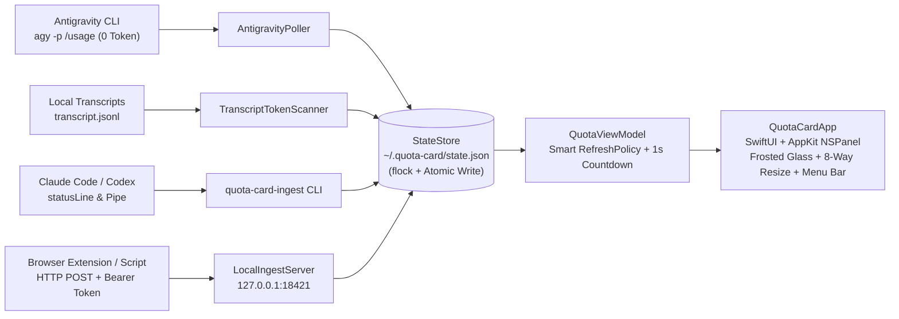

<div align="center">

# QuotaCard for macOS

**Native macOS Frosted-Glass Desktop Widget for Real-Time AI Subscription Quotas, Reset Countdowns & Daily Token Usage**

[](https://github.com/kingben8898-source/QuotaCard/releases)
[](https://swift.org)
[](#tech-stack--project-structure)
[](LICENSE)

[简体中文](README.md) | English

</div>

---

## Overview

**QuotaCard** is a lightweight, zero-dependency native macOS desktop widget built with SwiftUI and AppKit.

Floating gracefully on your desktop with native macOS frosted glass, it keeps your real-time subscription usage visible at a glance for **Antigravity (`agy`)**, **Claude Code**, **OpenAI Codex**, and custom local HTTP sources—without keeping a terminal open or spending any model tokens:

- **Dual-Window Remaining Quotas (5-Hour & Weekly)**
- **Live Reset Countdowns (down to the second)**
- **Daily Token Usage (Total, Input/Output split & per-pool breakdown)**

All data collection strictly uses official headless CLI commands, official `statusLine` hooks, documented local logs, or an authenticated `127.0.0.1` loopback API—**100% local, zero telemetry, zero token cost**.

---

## Key Features

### 1. Native Frosted-Glass UI & Fluid Desktop Interaction
- **True macOS Vibrancy**: Built with `NSVisualEffectView` and SwiftUI, offering live glass opacity tuning (`18% – 92%`) and **System / Dark / Light** appearance modes.
- **Desktop Layer vs. Always-on-Top**:
  - **Desktop Layer (default)**: Rests cleanly above your wallpaper and beneath normal windows so it never gets in the way.
  - **Floating Pin**: Toggle always-on-top mode to follow you across every Space and fullscreen workflow.
- **8-Way Edge & Corner Proportional Resizing (`75% – 145%`)**: Drag any of the 4 edges or 4 corners to resize smoothly (with native macOS 15+ resize cursors), or fine-tune via the quick appearance drawer (`◐`) and Settings (`⚙`). Position and scale persist automatically with multi-monitor screen clamping.
- **Unobtrusive Menu Bar Companion**: Runs as an `LSUIElement` app with no Dock clutter. Clicking `×` hides the card while keeping live lowest-quota and daily token readouts in the macOS menu bar.

### 2. Dual-Window Quota Matrix & Daily Token Analytics
- **Left-Right Matrix Layout**: Displays each model pool alongside its **5-Hour** and **Weekly** remaining percentages, color-coded progress bars, and individual reset timers (`HH:MM:SS` under 24h, `Xd Xh` over 24h).
- **Accurate Daily Token Tracking**: Scans documented local Antigravity `transcript.jsonl` logs and CLI hook payloads to aggregate today's total tokens, input/output split, and per-pool usage—automatically rolling over to zero at local midnight.
- **Built-In Demo Mode**: Preview the multi-pool layout and visual themes anytime before connecting a CLI.

### 3. Smart Power-Saving Background Refresh (No Terminal Needed · 0 Tokens)
- **Headless Zero-Token Polling**: Silently runs the official `agy -p "/usage" --output-format json` (`num_turns: 0`, `total_tokens: 0`) in the background—no open terminal required.
- **Five Configurable Refresh Policies** (in `⚙` Settings):

| Mode | Trigger Strategy | Best For |
| :--- | :--- | :--- |
| **Smart Power-Saving (Default)** | Lightweight 30s local log scan triggers a quota refresh only when **new conversation tokens appear** (2-min cooldown) + **15-min fallback** + **auto-refresh 5s after any countdown hits zero** + **wake-from-sleep / screen-wake refresh** (30s debounce) | Most MacBook users (best balance of freshness & battery life) |
| **Every 5 / 10 / 15 Minutes** | Fixed background interval + countdown-reset & wake refresh | Heavy multi-device concurrent usage |
| **Manual Only** | Refreshes only when clicking `↻` or manual fetch in Settings | Maximum battery savings |

- **Rock-Solid Background Execution**: Protected against macOS App Nap timer throttling, pipe buffer deadlocks (via temp-file capture), and hung subprocesses (with timeout termination).

### 4. Multi-Provider Support & Extensible Local API
Switch seamlessly across **AGY / Claude / Codex** tabs from the card header:
- **Antigravity (`agy`)**: Works out of the box with headless quota polling + local `transcript.jsonl` daily token aggregation.
- **Claude Code (`claude`)**: One-click official `statusLine` hook setup inside `⚙` Settings—automatically backs up `~/.claude/settings.json` (`.bak`), chains your existing custom statusline without breaking it, and supports one-click restore.
- **OpenAI Codex CLI**: Pipe `rateLimits` JSON directly into `quota-card-ingest --provider codex` (or `scripts/codex-ingest.sh`).
- **Local Authenticated HTTP API (`127.0.0.1:18421`)**: Ready for browser extensions (e.g., Gemini Web / ChatGPT Web) and custom scripts.

### 5. Privacy & Security by Design
- **100% Local**: Zero external analytics, zero cloud sync, zero prompt/conversation uploads.
- **Strictly Official & Sanctioned Interfaces**: Never probes undocumented desktop ports, never injects into other processes, never reads browser cookies.
- **Hardened Loopback Server**: Binds strictly to `127.0.0.1`, generates a `0600` 32-byte random Bearer token on first run, and verifies tokens in constant time.
- **Concurrency-Safe Storage**: Uses `flock` file locking and atomic replacement writes on `~/.quota-card/state.json`.

---

## Architecture



---

## Installation & Quick Start

### Requirements
- **OS**: macOS 14.0 (Sonoma) or later (Apple Silicon & Intel)
- **Building from source**: Xcode Command Line Tools (Swift 6.0+) — **no full Xcode.app required**

### Option 1: Download Pre-Built App (Recommended)
1. Download `QuotaCard-macOS.zip` from [GitHub Releases](https://github.com/kingben8898-source/QuotaCard/releases).
2. Unzip and drag `QuotaCard.app` into `/Applications`.
3. Because this open-source build is ad-hoc signed, if macOS Gatekeeper blocks the first launch, clear the quarantine attribute once and open it:
   ```bash
   xattr -cr /Applications/QuotaCard.app
   open /Applications/QuotaCard.app
   ```

### Option 2: Build from Source
```bash
git clone https://github.com/kingben8898-source/QuotaCard.git
cd QuotaCard
./scripts/build-app.sh
open dist/QuotaCard.app
```

---

## Usage & Integrations

### Card Header Controls

| Control | Action |
| :--- | :--- |
| `AGY` / `Claude` / `Codex` | Switch active AI provider tab |
| `贴桌面` / `置顶` | Toggle Desktop Layer vs. Always-on-Top |
| `◐` | Quick appearance drawer (glass opacity, scale, light/dark theme) |
| `⚙` | Settings & Integrations (refresh policy, CLI hooks, local API token, demo mode) |
| `↻` | Trigger immediate manual refresh |
| `×` | Hide floating card to menu bar without quitting |

### Local HTTP API Example
- Health check: `GET http://127.0.0.1:18421/v1/health`
- Push snapshot: `POST http://127.0.0.1:18421/v1/providers/<provider-id>`
- Authenticate with `Authorization: Bearer <token>` from `~/.quota-card/auth-token` (or copy from Settings `⚙`):
```bash
TOKEN=$(cat ~/.quota-card/auth-token)
curl -X POST "http://127.0.0.1:18421/v1/providers/gemini-web" \
  -H "Authorization: Bearer $TOKEN" \
  -H "Content-Type: application/json" \
  -d '{
    "displayName": "Gemini Web",
    "sourceLabel": "Browser Ext",
    "pools": [
      {
        "id": "gemini",
        "name": "Gemini",
        "fiveHour": { "remainingPercent": 82.5, "resetAt": "2026-11-25T18:00:00Z" },
        "weekly": { "remainingPercent": 90.0, "resetAt": "2026-12-01T00:00:00Z" }
      }
    ]
  }'
```

---

## Tech Stack & Project Structure

- **Stack**: Pure Swift 6.0, SwiftUI, AppKit, Network.framework (**Zero third-party dependencies**)
- **Tests**: 47 built-in unit & integration tests (zero `XCTest` dependency; runs directly with Command Line Tools)

```text
QuotaCard/
├── Package.swift                  # Swift Package manifest (Core / Ingest CLI / App / Tests)
├── Sources/
│   ├── QuotaCardCore/             # Models, StateStore, PayloadParser, RefreshPolicy, LocalIngestServer, WindowGeometry, TranscriptTokenScanner
│   ├── QuotaCardIngest/           # Zero-dependency CLI helper for statusLine & pipe ingestion
│   └── QuotaCardApp/              # SwiftUI card views, AppKit NSPanel, 8-way resize overlay, menu bar & settings
├── Tests/QuotaCardCoreTests/      # 47 unit & end-to-end integration tests
└── scripts/
    ├── build-app.sh               # macOS .app bundle build script
    ├── agy-statusline.sh          # Antigravity statusLine bridge
    ├── claude-statusline.sh       # Claude Code statusLine bridge
    └── codex-ingest.sh            # Codex CLI stdin forwarder
```

### Run Tests
```bash
swift build && swift run QuotaCardTests
```

---

## License

Released under the [MIT License](LICENSE). Contributions, issues, and pull requests are welcome!
